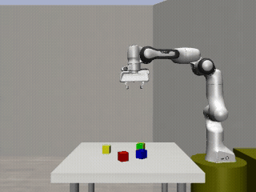
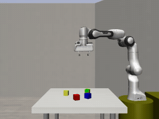
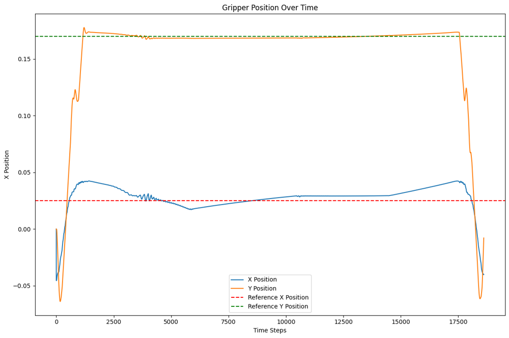
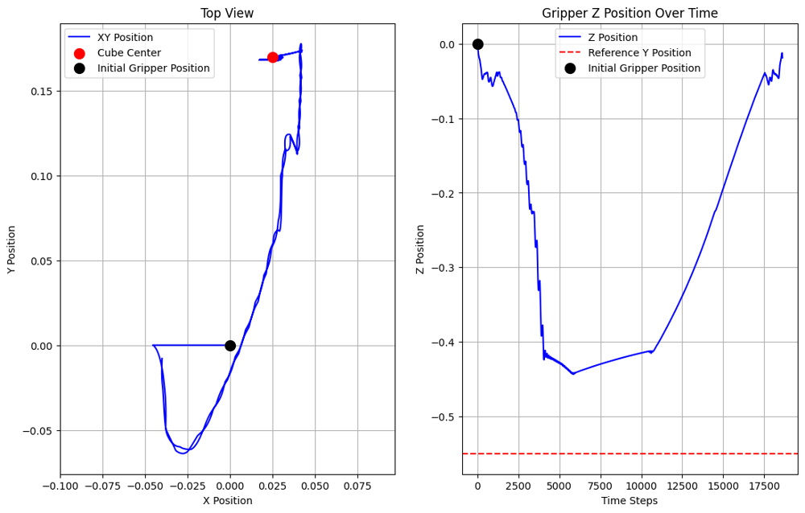
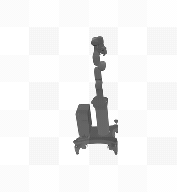

# 🦾 Robotic Manipulator Control & Simulation

> Robotics course projects (Chung-Ang University, Mechanical Engineering, Spring 2024, individual work) · DYROS Robotics Bootcamp 1 & 2 (Seoul National University, Jul–Aug 2023) · undergraduate research in the AIS Lab, RAIS team (Fall 2023).

---

## 📖 Overview

This repository summarizes my experience in robotic manipulator modeling, planning, control and simulation, centered on a **Franka Emika Panda** arm simulated in **MuJoCo**.

It brings together three experiences:

- **Robotics course (CAU, 2024)**: URDF parsing, forward kinematics, Jacobian, damped least-squares inverse kinematics, RRT* / Cartesian planning and PID control
- **DYROS Robotics Bootcamp 1 & 2 (SNU, 2023)**: robotics bootcamp run by the Dynamic Robotic Systems Lab
- **AIS Lab research (RAIS team, 2023)**: lab seminars on manipulator kinematics vs. dynamics and force control (impedance vs. hybrid position/force control) for safe human–robot interaction

---

## 🎯 Final Project: Object Grasping with a Panda Arm (MuJoCo)

Goal: find each cube's pose on the table, compute a grasp pose for the gripper, plan a collision-free path to it, and make the robot follow that path.

### Path Planning Pipeline

| Raw Environment (no controller) | Cartesian Planner | RRT* Planner |
|:---------------:|:------------:|:------------:|
|  |  |  |
| Torque-actuated model falls under gravity | Straight-line end-effector motion | Sampling-based joint-space path |

The planner videos above show planned paths replayed without the PID controller.

### Control: PID with Gravity Compensation

| PID holds the pose | Whole-body target tracking (5× speed) |
|:---:|:---:|
|  |  |
| Joint PID keeps the arm from falling under gravity | RRT* + Cartesian paths to each cube, followed with PID |

### Pipeline

1. **Object pose**: read each cube's position and orientation from the MuJoCo scene.
2. **Grasp pose**: compute aligned, intermediate, pre-grasp and grasp poses of the gripper from the cube pose.
3. **Inverse kinematics**: Jacobian-based IK from sampled joint configurations, with a collision checker.
4. **Planning**: RRT* to an aligned pose above the cube, then Cartesian planner segments down to the grasp pose.
5. **Control**: joint-space PID with gravity compensation to follow the planned path.

### Results (from the project notebook)

| Item | Result |
|---|---|
| RRT* (3 runs, same start/goal) | paths of 58, 131 and 657 waypoints, each found in about 6.4–6.9 s |
| Cartesian planner (X-axis move) | 101-waypoint path in 0.04 s; the Y-axis move failed to find a path |
| Jacobian IK | final error on the order of 1e-8 to 1e-6 |

| Gripper X/Y position vs. reference | Top view and gripper Z position |
|:---:|:---:|
|  |  |

---

## 🧮 Midterm Project: Inverse Kinematics Solver



Built from scratch in Python on a Panda URDF:

- URDF parser and recursive forward kinematics over the link tree
- TCP (tool center point) pose lookup
- Geometric Jacobian for revolute and prismatic joints
- Pose error (translation + rotation) between two configurations
- Inverse kinematics with the damped least-squares (Levenberg–Marquardt) method; in the test case the pose error reached about 4e-10 by iteration 6

The GIF shows the Panda model (with pedestal) loaded by the parser.

<br clear="right">

---

## 🧩 Project Components

| Area | Description |
|---|---|
| Manipulator Kinematics | URDF parsing, forward kinematics, Jacobian, damped least-squares IK |
| Motion Planning | RRT* in joint space and a Cartesian straight-line planner with collision checking |
| Grasp Planning | Grasp poses computed from object poses in the simulation |
| Control | Joint-space PID control with gravity compensation |
| Simulation | MuJoCo (Franka Emika Panda with a 4-cube table scene) |
| Force Control (study) | Impedance vs. hybrid position/force control, reviewed in AIS Lab seminars |
| HRI Perspective | Why force control matters for safe contact with people and objects |

---

## 🔧 Technical Stack

- **Languages**: Python (Jupyter / Google Colab)
- **Simulation**: MuJoCo
- **Robot Model**: Franka Emika Panda (MJCF and URDF)
- **Control**: PID control, gravity compensation, trajectory tracking
- **Concepts**: Forward / Inverse Kinematics, Jacobian, Damped Least Squares, RRT*, Collision Checking, Impedance Control, HRI

---

## 🧠 What I Learned

- Built a foundation in robotic manipulator kinematics, dynamics, and control
- Learned how planning, inverse kinematics and control fit together in one grasping pipeline
- Practiced simulation-first validation before hardware deployment
- Understood the importance of safety, compliance, and validation in human–robot interaction
- Developed a broader perspective on connecting theory, simulation, and real robotic systems

---

## 📌 Role & Contributions

- Studied core manipulator theory through robotics coursework
- Implemented ROS-based manipulator examples during Seoul National University ROS Bootcamp
- Built and tested simulation environments for robotic system validation
- Conducted hardware-level manipulator experiments in AIS Lab
- Explored safe robot behavior and control strategies for HRI applications

---

## 📁 Repository Structure

```
RobotManipulatorSimulation/
├── README.md
└── images/
    ├── final_project/   # PID / grasping GIFs and tracking plots (MuJoCo)
    └── midterm_ik/      # Panda model loaded by the URDF parser
```

The project code lives in the course notebooks and is not included in this repository.

---

## 🚀 Research Direction

This project strengthened my interest in reliable robotic manipulation systems that integrate:

- motion planning
- control
- simulation-based validation
- safe physical interaction
- human-centered robotic applications

It became an important foundation for my later work in assistive robotics, autonomous systems, and emergency robotic planning.
